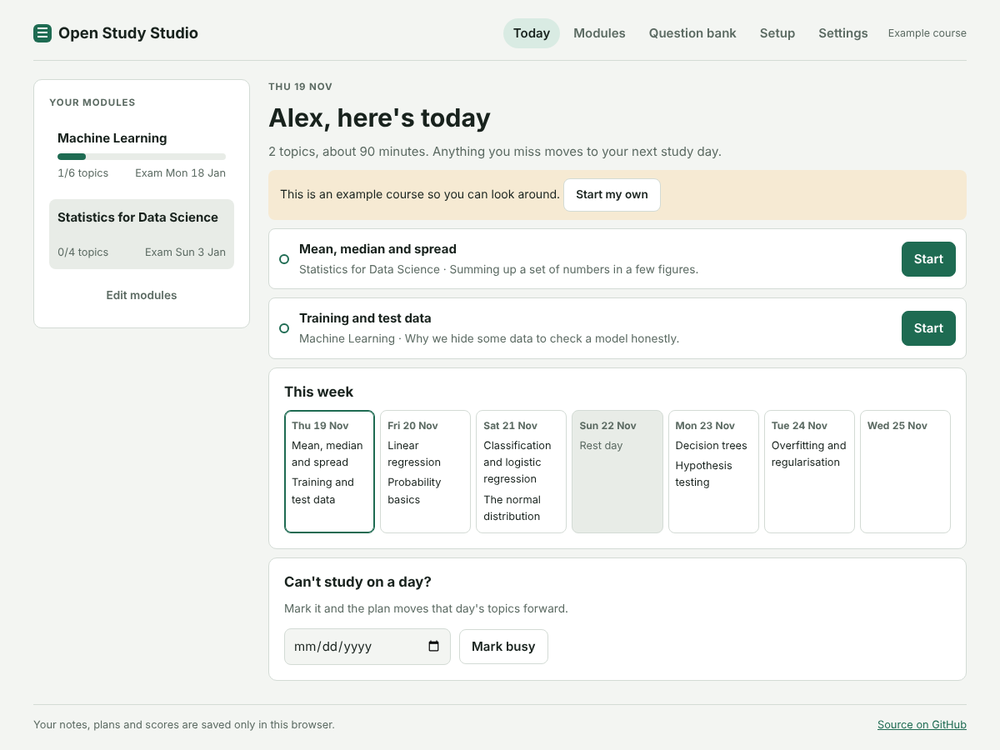

# Open Study Studio

An AI study tutor for any student. Upload your lecture notes or slides and it builds a daily study plan, teaches each topic from the basics using your own material, and sets practice questions that get harder as your scores improve.

**Live app:** https://navyata-nagaraju.github.io/open-study-studio/



## What it does

- **Setup.** Enter your course, level, modules, exam dates, study days and minutes per day. Upload PDFs, text files or lecture captions for each module, or paste notes in. You can change all of it at any time.
- **A plan that never piles up.** The app breaks each module into 8 to 18 topics, ordered from basics to advanced, then spreads them over your study days before each exam. The plan is worked out again from today every time you open it, so a missed day moves work forward instead of leaving a backlog. You can mark days when you can't study.
- **Learn, check, practise.** Each topic has three steps:
  1. **Learn.** A plain-English lesson that starts with an everyday picture, then a worked example, then the technical terms. It is grounded in the passages of your notes that best match the topic.
  2. **Check understanding.** Three quick multiple-choice questions that don't count towards your score.
  3. **Practise.** Three exam or interview-style questions at a difficulty from 1 to 5 based on your past scores. The AI marks your answers out of 10 with feedback and a model answer.
- **Spaced review.** Topics scored below 70% come back for a short review three days later.
- **Question bank.** Every practice question you answer is saved with its model answer and can be downloaded as a Markdown file for revision.
- **Private by design.** There is no server. Everything is stored in your own browser, and your API key is sent only to the AI provider you choose. Backup and restore let you move your data between devices.

## How it works

```
 your notes ──► chunk ──► stored in the browser (IndexedDB)
                              │
 topic title + keywords ──► BM25 search ──► best 3-4 passages
                                                │
                                   prompt ─────►  LLM (Gemini or Claude)
                                                │
                       lesson / questions / marks ◄┘
                                                │
                score ──► planner ──► difficulty, reviews, tomorrow's plan
```

This is **retrieval-augmented generation (RAG)**. Instead of asking the model to teach from general knowledge, the app first finds the most relevant parts of the student's own notes and puts them in the prompt, so lessons match the course's notation and examples.

| File | Job |
| --- | --- |
| `js/retrieval.js` | Splits notes into chunks and ranks them for a topic with BM25, the classic search-engine scoring formula |
| `js/planner.js` | Schedules topics across study days by exam urgency, handles missed days, reviews and difficulty |
| `js/llm.js` | One `complete()` function for Google Gemini and Anthropic Claude, with streaming and JSON parsing |
| `js/prompts.js` | Every instruction sent to the model, in one place |
| `js/store.js` | Saves and loads everything in the browser with IndexedDB, plus backup and restore |
| `js/app.js` | The interface: Today, Modules, lessons, Question bank, Setup and Settings |

A longer explanation of each part is in [docs/HOW_IT_WORKS.md](docs/HOW_IT_WORKS.md).

## Use it

1. Open the live app.
2. Go to **Settings** and paste an API key:
   - **Google Gemini** has a free tier. Get a key at https://aistudio.google.com/apikey
   - **Anthropic Claude** is paid. Get a key at https://console.anthropic.com/settings/keys
3. Go to **Setup**, add your modules and upload your notes, then click **Create my plan**.

You can also click **Look around an example course first** to see the app without a key.

## Run it on your own computer

No build step or installs are needed. The app uses JavaScript modules, so it has to be served rather than opened as a file:

```bash
git clone https://github.com/navyata-nagaraju/open-study-studio.git
cd open-study-studio
python3 -m http.server 8000
# then open http://localhost:8000
```

## Tests

The planner and retrieval logic are pure functions with unit tests (Node 18 or newer, nothing to install):

```bash
npm test
```

## Limits and next steps

- Scanned PDFs have no text layer, so they need to be pasted as text. OCR would fix this.
- BM25 matches words, not meaning. Embedding-based search would find passages that use different words for the same idea.
- Data stays in one browser. A small backend with sign-in would allow syncing across devices.
- Calling the AI provider straight from the browser is fine for a personal tool, but a shared deployment should route requests through a server so keys are never exposed.

## Author

Designed and developed by **Navyata Nagaraju**, MSc Generative AI student at the University of Exeter, with Claude (Anthropic) used as an AI pair programmer.
[LinkedIn](https://www.linkedin.com/in/navyata-nagaraju)

Licensed under the MIT Licence.
